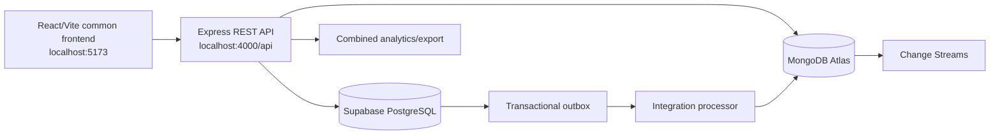

# System Architecture

## Purpose and scope

CampusLink uses one common React client and one Node/Express backend to access two authoritative databases. This is a practical teaching architecture, not a production enterprise platform.

## Fixed technology decisions

**Frontend:** React, Vite, JavaScript (not TypeScript), plain CSS (not Tailwind), React Router, native Fetch API.  
**Backend:** Node.js 26 LTS, Express 5, REST, JavaScript ES modules.  
**PostgreSQL:** Supabase Free, accessed with `pg`; owns campuses, buildings, rooms, users, reservations, and `integration_outbox`.  
**MongoDB:** Atlas Free, accessed with the official `mongodb` driver; owns service requests, comments, activity history, and integration events. Other packages are `cors`, `dotenv`, `bcryptjs`, and `jsonwebtoken`. No ORM. Use Node `--watch` where appropriate.

## Responsibilities

The instructor-provided frontend renders the supplied interface, collects
input, calls the API, and displays status. The instructor-provided backend
starter supplies the Express application, CORS/JSON middleware, basic error
handling, environment template, and registered route structure. Students
implement backend authentication, authorization, validation, parameterized SQL
or MongoDB operations, outbox processing, combined analytics, and health
integration. PostgreSQL is authoritative for campus and reservation integrity.
MongoDB is authoritative for service-request history and integration events.

Students are not required to design the entire Express server architecture from
scratch. The starter deliberately leaves database-dependent routes as
`501 Not Implemented` and leaves database connection modules as educational
TODO placeholders.

## Data flow

The client calls `http://localhost:4000/api`. A reservation transaction writes both the reservation and its PostgreSQL outbox record before commit. A backend processor sends pending events to MongoDB using a stable event ID, then marks the outbox row synchronized. Service-request changes can be observed through MongoDB Change Streams. Analytics reads both databases and combines results in the backend.

## Local ports and environment

Frontend: `http://localhost:5173`; backend: `http://localhost:4000`; API base: `http://localhost:4000/api`. Frontend variables are `VITE_API_BASE_URL` and `VITE_DEMO_MODE`. Backend
variables are `PORT`, `DATABASE_URL`, `MONGODB_URI`, `MONGODB_DB`,
`MONGODB_DNS_SERVERS`, `JWT_SECRET`, and `FRONTEND_ORIGIN`. `MONGODB_DNS_SERVERS`
is an optional comma-separated student troubleshooting setting for Node.js SRV
resolution; it is not used by the unconnected instructor starter. Secrets
remain backend-only.

## Actual versus capability

The student implementation demonstrates two databases, eventual synchronization, transactions, retries, Change Streams, and query analysis. Supabase and Atlas may provide managed replication and availability features, which must be examined and documented. A single managed deployment is not manual sharding or student-implemented failover. Campus fragmentation/partitioning may be conceptual or demonstrated with a simple partition-aware query. Label every claim as actual implementation, managed capability, demonstration/simulation, or future enhancement.

## Related documents

[Database design](05-DATABASE-DESIGN.md), [integration](06-DATA-INTEGRATION-AND-RELIABILITY.md), and [API contract](04-API-CONTRACT.md).
