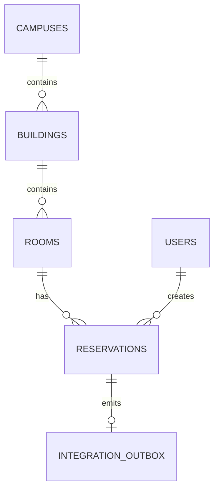

# Database Design

## Ownership

PostgreSQL is authoritative for `campuses`, `buildings`, `rooms`, `users`, `reservations`, and `integration_outbox`. MongoDB is authoritative for `service_requests`, `activity_logs`, and `integration_events`. A MongoDB document may store a PostgreSQL room ID as a normal identifier; it is not a cross-database foreign key.

## PostgreSQL schema

Suggested columns are illustrative implementation details and must preserve the stated ownership. `campuses(id PK, name, location)`. `buildings(id PK, campus_id FK, name)`. `rooms(id PK, building_id FK, campus_id FK, name, capacity, status)`. `users(id PK, email UNIQUE, password_hash, role, name)`. `reservations(id PK, resource_id FK, user_id FK, reservation_date, time_slot, status, idempotency_key, created_at)`. `integration_outbox(id PK, event_id UNIQUE, event_type, aggregate_id, payload, status, attempts, last_error, synchronized_at, created_at)`.

Relationships: one campus has many buildings; one building has many rooms; one resource/room and one user have many reservations. Use foreign keys, unique constraints, and indexes. CampusLink uses these project-defined, non-overlapping values for `time_slot`: `08:00-10:00`, `10:00-12:00`, `13:00-15:00`, and `15:00-17:00`. Add a unique partial index for active reservations on `(resource_id, reservation_date, time_slot)`, so a resource cannot have two active reservations for the same date and slot. This scheduling rule is an instructor-selected project decision, not an official university scheduling policy. Use parameterized SQL.

## MongoDB collections

`service_requests` stores `_id`, requester identifier, title, description, category, priority, status, related PostgreSQL room ID where applicable, timestamps, and comments or comment references. `activity_logs` stores request ID, actor ID, action, old/new status, and timestamp. `integration_events` stores stable `eventId` (unique), event type, payload, source, received time, and processing metadata.

Example request: `{ "_id": "sr-1", "requesterId": "u-1", "title": "Projector issue", "category": "IT", "priority": "normal", "status": "open", "relatedRoomId": "room-1", "createdAt": "..." }`. Example event: `{ "eventId": "evt-1", "eventType": "reservation.created", "aggregateId": "res-1", "payload": {}, "receivedAt": "..." }`.

## Idempotency and indexes

Store the reservation idempotency key with the authenticated user and request fingerprint. A repeated key with the same request returns the committed result; reuse with a different payload is rejected. Index PostgreSQL foreign keys, reservation lookup fields, active reservation conflict fields, and outbox status. Index MongoDB request status/category/priority, requester, activity request ID, and unique `integration_events.eventId`.

## ER diagram

## Related documents

[Architecture](03-SYSTEM-ARCHITECTURE.md), [integration](06-DATA-INTEGRATION-AND-RELIABILITY.md), and [security](07-SECURITY-AND-GITHUB-WORKFLOW.md).
